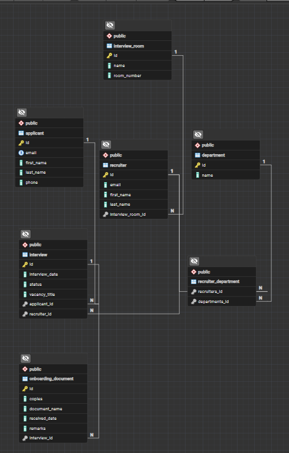
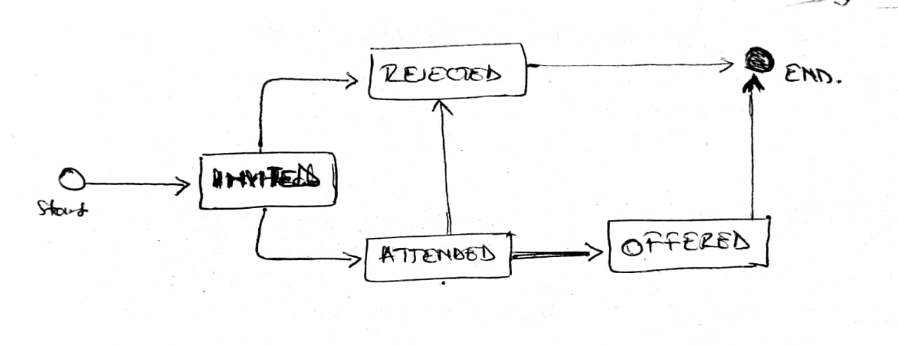

# HR Recruitment Management System

- **Project name:** h-r-recruitment-management-system-backend
- **Course:** Web Technology and Internet (INSY 8322), Mid-Term Project, AUCA
- **Student:** Uwase Leiss
- **Student ID:** 27064
- **Built with:** Java 17, Spring Boot, Spring Data JPA, PostgreSQL, Maven, Postman

---

## About the project

This is a backend REST API for the interview process at Kabuye Sugar Works. An applicant is invited to an interview with a recruiter. The interview starts as `INVITED`, then becomes `ATTENDED`, and ends as `OFFERED` or `REJECTED`. A recruiter works from one interview room and can recruit for several departments. When an applicant is `OFFERED`, the recruiter saves the onboarding documents the applicant brings.

There are six entities: Applicant, Recruiter, Department, InterviewRoom, Interview and OnboardingDocument. I built them one at a time, with the same layers we used in class: controller, service and repository.

---

## Architecture


- The **controller** receives the request, reads the path, parameters and JSON body, calls the service, and chooses the HTTP status.
- The **service** has the business rules (past dates, double booking, allowed status changes) and returns a list, an `Optional` or a message.
- The **repository** is an interface that extends `JpaRepository`. Simple searches are derived from the method name. The harder ones use JPQL with `@Query`.

---

## ER Diagram



A recruiter can have many departments and a department can have many recruiters, so they are joined by the table `recruiter_department`. The interview status is saved as text (`EnumType.STRING`), so the database shows `OFFERED` and not a number.

---

## Interview lifecycle



`OFFERED` and `REJECTED` are final. Any other change of status returns 400. The normal `PUT` update does not change the status.

---

## Endpoints

| Req. | Method and path | Success | Errors |
|---|---|---|---|
| A2 | `POST /save`, `GET /all`, `GET /{id}`, `PUT /update/{id}`, `DELETE /delete/{id}` under `/api/departments`, `/api/interview-rooms`, `/api/recruiters`, `/api/applicants`, `/api/interviews` | 201 / 200 | 404 unknown id |
| B1 | `GET /api/applicants/by-last-name?lastName=` | 200 | |
| B2 | `GET /api/interviews/by-status?status=INVITED` | 200 | 400 invalid status |
| B3 | `GET /api/interviews/between?start=2026-10-01&end=2026-10-31` | 200 | |
| C1 | `GET /api/recruiters/by-department?name=fin` | 200 | |
| C2 | `GET /api/interview-rooms/free` | 200 | |
| C3 | `GET /api/departments/unused` | 200 | |
| C4 | `GET /api/applicants/of-recruiter/{recruiterId}` | 200 | 404 recruiter not found |
| D1 | `POST /api/interviews/save` | 201 | 400 past date or missing data, 409 recruiter already booked that day |
| D2 | `PATCH /api/interviews/{id}/status?status=ATTENDED` | 200 | 400 move not allowed, 404 unknown id |
| D3 | `PUT /api/recruiters/{recruiterId}/departments/{departmentId}` | 200 | 404 unknown recruiter or department, 409 already has it |
| D4 | `PATCH /api/recruiters/{recruiterId}/interview-room?roomNumber=4` | 200 | 404 unknown recruiter or room, 409 room taken |
| E1 | `POST /api/onboarding-documents/save?interviewId=` | 201 | 404 unknown interview, 400 interview not OFFERED |
| E2 | `GET /api/onboarding-documents/applicant/{email}` | 200 | |
| E3 | `DELETE /api/onboarding-documents/delete/{id}` and `DELETE /api/interviews/delete/{id}` | 200 | 404 unknown document, 409 interview still has documents |
| F1 | `GET /api/interviews/stats/by-status` | 200 | |
| F2 | `PATCH /api/interviews/cancel-day?recruiterId=&date=2026-10-20` | 200 | |

---

## Run it yourself

You need a JDK (17 or newer), PostgreSQL and Git. The project has the Maven wrapper, so you do not need to install Maven.

```
git clone https://github.com/Mrs-luwase/h-r-recruitment-management-system-backend.git
cd h-r-recruitment-management-system-backend
```

1. In pgAdmin, create an empty database called `hr_recruitment_db`.
2. Open `src/main/resources/application.properties` and write your own PostgreSQL username and password:
   ```
   spring.datasource.username=<your username>
   spring.datasource.password=<your password>
   ```
3. Start the API from the project folder:
   ```
   ./mvnw spring-boot:run
   ```
   On Windows `cmd`, use `mvnw.cmd spring-boot:run`.
4. The API runs on http://localhost:8080 and Hibernate creates the tables on the first start.
5. The database is empty at first. Add data with the `save` endpoints in this order because of the foreign keys: departments, interview rooms, recruiters, applicants, interviews. The `seed` folder in the Postman collection shows the data I used. The seed interviews have dates in the past now, so rule D1 will reject them if you run them again. Use future dates.

---

## Testing with Postman

The collection is in the root of the repository: `h-r-recruitment-management-system-midterm.postman_collection.json`. The requests start with the requirement ID, for example `D2-status-valid`.

| Folder | What it has |
|---|---|
| `seed` | The requests I used to fill the database |
| `Part A` to `Part C` | The basic CRUD, the derived queries (B) and the JPQL queries (C) |
| `00-setup` | GET requests that save ids as collection variables |
| `Part D`, `Part E`, `Part F` | The business rules, each success next to its error case |

To run it:

1. Import the collection file in Postman and start the API.
2. Run the folder `00-setup` once, so the ids are saved as variables.
3. Run `Part D`, `Part E` and `Part F`. The checks show green or red.

Run `00-setup` only when the data is in its normal state.

---

## Project structure

```
h-r-recruitment-management-system-backend/
  src/main/java/ksw/h_r_recruitment_management_system/
    domain/        the entities and the InterviewStatus enum
    repository/    one repository interface per entity
    service/       one service per entity
    controller/    one controller per entity
  src/main/resources/application.properties
  docs/            the three diagrams
  pom.xml
  h-r-recruitment-management-system-midterm.postman_collection.json
  README.md
```

---

## What I learned

- An entity is a class that becomes a table, and `@ManyToOne` with `@JoinColumn` creates the foreign key column.
- A repository is an interface. Spring builds the class from the method name, or from the `@Query` I write.
- A derived query is enough for simple filters. I needed JPQL for joins, `NOT EXISTS`, `IS EMPTY`, `GROUP BY` and the update.
- The business rules stay in the service, and the controller turns the result into 400, 404 or 409.
- `DISTINCT` is needed when a join repeats the same row.
- A bulk `UPDATE` needs `@Modifying` and `@Transactional`.

---

## Challenges I met

- `ddl-auto=update` does not rename a column. I named a join column wrongly, and after I fixed the annotation the old column stayed in the table.
- After rule D1, the seed interviews with old dates were rejected. I had to enter the seed data first and use future dates in the tests.
- For `cancel-day`, my tests create their own interviews and delete them after, so the seed data stays the same.

---

## Recommendation

- Add a login and security layer, for example Spring Security.
- Use DTOs and validation instead of sending the entities directly.
- The rule "one recruiter per room" is only checked in the service. A database constraint would be safer.
- `cancel-day` also counts interviews that were already `REJECTED`, because my rule is "every interview except the OFFERED ones". It could skip them with one more condition in the query.
- Add unit tests for the service rules.

---

## Signature

**Author: Uwase Leiss, ID 27064**
