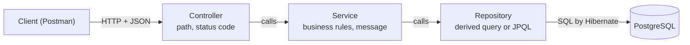
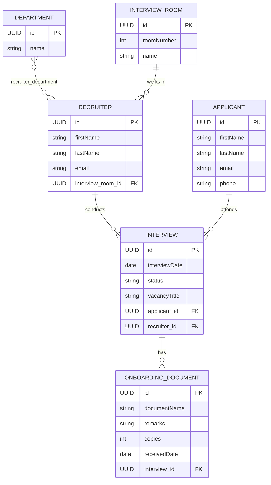
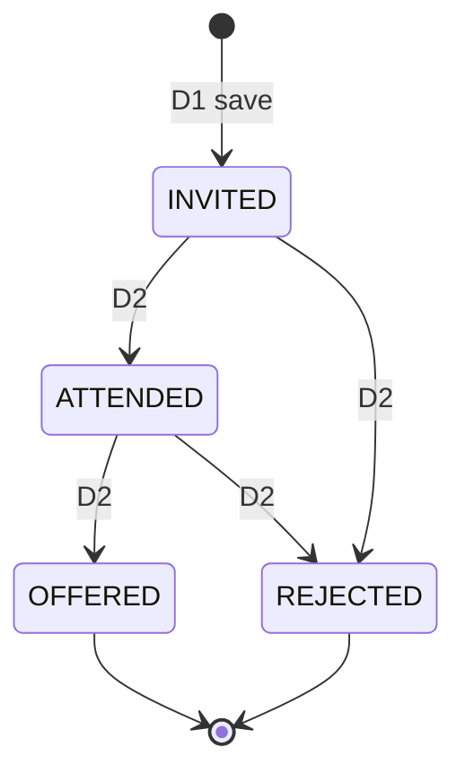

<h1 align="center">HR Recruitment Management System</h1>

<p align="center">
  A backend REST API that manages the whole interview journey: invite an applicant, hold the interview, make an offer, and record the onboarding documents.
</p>

<p align="center">
  
  
  
  
  
  
  
</p>


<p align="center">
  <b>Course:</b> Web Technology and Internet &nbsp;|&nbsp; <b>Course code:</b> INSY 8322<br>
  <b>Student:</b> Uwase Leiss &nbsp;|&nbsp; <b>Student ID:</b> 27064
</p>

<p align="center">
  <sub>Mid-Term Project, AUCA</sub>
</p>

---

<h2 align="center">About the project</h2>

The HR Recruitment Management System gives Kabuye Sugar Works a digital channel for its interviews. An applicant is invited to an interview run by a recruiter. The interview moves from `INVITED` to `ATTENDED` and ends `OFFERED` or `REJECTED`. Each recruiter works from one interview room and hires for several departments, such as production or finance. Once an offer is made, the recruiter records the onboarding documents received from the new hire.

I built the backend with Spring Boot, Spring Data JPA and PostgreSQL, one entity at a time, following the same layered style used in class.

What the API does:

- **Manages six entities:** Applicant, Recruiter, Department, InterviewRoom, Interview and OnboardingDocument, each with save, list, get by id, update and delete.
- **Searches in several ways:** applicants by last name, interviews by status or between two dates, recruiters by department, free rooms, unused departments, and the applicants a recruiter has interviewed.
- **Protects the interview flow:** a new interview always starts as `INVITED`, cannot be in the past, and cannot double-book a recruiter. Status can only move along the allowed path.
- **Handles recruiter changes:** add a department to a recruiter without losing the others, and move a recruiter to another room only if it is free.
- **Records onboarding documents** only for `OFFERED` interviews, and blocks deleting an interview that still has documents.
- **Reports and bulk updates:** interview counts per status, and cancelling a recruiter's whole day in one database statement.
- **Answers with clear messages and HTTP statuses** (400, 404, 409) instead of raw errors.

---

<h2 align="center">Project at a glance</h2>

| | |
|---|---|
| Requirements | 18, in six parts (A to F) |
| Entities | 6 (plus the `InterviewStatus` enum) |
| Layers | 3: controller, service, repository |
| Query styles | Derived queries (Part B), JPQL (Parts C, E2 and F), `existsBy` checks for the rules |
| Database | PostgreSQL 17, tables created by Hibernate (`ddl-auto=update`) |
| API tests | Postman collection with a setup folder and automated checks (Parts D, E and F: 52 requests) |
| Response style | Entities used directly as request and response bodies, services return a `List`, an `Optional` or a message, the controller maps the message to an HTTP status |

---

<h2 align="center">Architecture</h2>

Every request goes through the same three layers.



| Layer | Job |
|---|---|
| **Controller** | Receives the HTTP request, reads the path, parameters and JSON body, calls the service, and turns the service's message into an HTTP status. |
| **Service** | Holds the business rules (past dates, double booking, allowed status moves). Returns a `List`, an `Optional` or a message. |
| **Repository** | An interface extending `JpaRepository`. Spring Data builds the implementation. Simple searches are derived from the method name, harder ones use JPQL. |

---

<h2 align="center">Data model</h2>



The status is stored as text (`EnumType.STRING`), so the database shows `OFFERED` and not a number, and reordering the enum later cannot corrupt old rows.

---

<h2 align="center">Interview lifecycle</h2>



`OFFERED` and `REJECTED` are final. Any other move returns `400`. The general `PUT` update never changes the status.

---

<h2 align="center">Endpoints</h2>

| Req. | Method and path | Success | Error cases |
|---|---|---|---|
| A2 | `POST /save`, `GET /all`, `GET /{id}`, `PUT /update/{id}`, `DELETE /delete/{id}` under `/api/departments`, `/api/interview-rooms`, `/api/recruiters`, `/api/applicants`, `/api/interviews` | 201 / 200 | 404 unknown id |
| B1 | `GET /api/applicants/by-last-name?lastName=` | 200 | |
| B2 | `GET /api/interviews/by-status?status=INVITED` | 200 | 400 invalid status |
| B3 | `GET /api/interviews/between?start=2026-10-01&end=2026-10-31` | 200 | 400 bad date format |
| C1 | `GET /api/recruiters/by-department?name=fin` | 200 | |
| C2 | `GET /api/interview-rooms/free` | 200 | |
| C3 | `GET /api/departments/unused` | 200 | |
| C4 | `GET /api/applicants/of-recruiter/{recruiterId}` | 200 | 404 recruiter not found |
| D1 | `POST /api/interviews/save` | 201 | 400 past date or missing data, 409 recruiter already booked that day |
| D2 | `PATCH /api/interviews/{id}/status?status=ATTENDED` | 200 | 400 move not allowed, 404 unknown id |
| D3 | `PUT /api/recruiters/{recruiterId}/departments/{departmentId}` | 200 | 404 unknown recruiter or department, 409 already held |
| D4 | `PATCH /api/recruiters/{recruiterId}/interview-room?roomNumber=4` | 200 | 404 unknown recruiter or room, 409 room taken |
| E1 | `POST /api/onboarding-documents/save?interviewId=` | 201 | 404 unknown interview, 400 interview not OFFERED |
| E2 | `GET /api/onboarding-documents/applicant/{email}` | 200 | |
| E3 | `DELETE /api/onboarding-documents/delete/{id}` and `DELETE /api/interviews/delete/{id}` | 200 | 404 unknown document, 409 interview still has documents |
| F1 | `GET /api/interviews/stats/by-status` | 200 | |
| F2 | `PATCH /api/interviews/cancel-day?recruiterId=&date=2026-10-20` | 200 | 400 bad date format |

<details>
<summary><b>Exact messages returned</b></summary>

| Status | Message |
|---|---|
| 404 | `The interview with that id does not exist` |
| 404 | `The recruiter with that id does not exist` |
| 404 | `That department does not exist` |
| 404 | `The interview room with that roomNumber does not exist` |
| 404 | `The onboarding document with that id does not exist` |
| 400 | `Interview date cannot be in the past` |
| 400 | `Cannot change status from OFFERED to INVITED` (the real current and requested status are inserted) |
| 400 | `Onboarding documents are only for OFFERED interviews` |
| 409 | `Recruiter already has an interview on that date` |
| 409 | `The recruiter already has that department` |
| 409 | `That interview room is taken by another recruiter` |
| 409 | `That interview has onboarding documents, delete them first` |
| 200 | `3 interviews cancelled` (F2, the real number of rows changed) |

</details>

---

<h2 align="center">Run it yourself</h2>

You need a JDK (17 or newer), PostgreSQL and Git. Maven is not needed, the project includes the Maven wrapper.

```
git clone https://github.com/Mrs-luwase/h-r-recruitment-management-system-backend.git
cd h-r-recruitment-management-system-backend
```

1. In pgAdmin, create an empty database called `hr_recruitment_db`.
2. Open `src/main/resources/application.properties` and put your own PostgreSQL username and password:
   ```
   spring.datasource.url=jdbc:postgresql://localhost:5432/hr_recruitment_db
   spring.datasource.username=<your username>
   spring.datasource.password=<your password>
   ```
3. Start the API from the project folder:
   ```
   ./mvnw spring-boot:run
   ```
   On Windows `cmd`, use `mvnw.cmd spring-boot:run`.
4. The API runs on **http://localhost:8080**. Hibernate creates all the tables on the first start.
5. The database starts empty. Create data through the `save` endpoints in this order, because of the foreign keys: departments, interview rooms, recruiters, applicants, interviews. The `seed` folder of the Postman collection shows the data I used.

---

<h2 align="center">Testing with Postman</h2>

The collection is in the root of the repository: `h-r-recruitment-management-system-midterm.postman_collection.json`. Each request is named by its requirement ID (A2, B1, C4, D2, ...).

| Folder | What it contains |
|---|---|
| `seed` | The requests I used to fill the database (for reference) |
| `Part A` | Save, list, get, update and delete for the five basic entities |
| `Part B` | B1 to B3, derived queries |
| `Part C` | C1 to C4, JPQL queries |
| `00-setup` | Four GET requests that read the ids from the database and save them as collection variables |
| `Part D` | 29 requests for the business rules, each success next to its error case, cleaning up after itself |
| `Part E` | 8 requests for the onboarding documents |
| `Part F` | 15 requests for the report and the bulk update |

**How to run it**

1. In Postman choose **Import** and select the collection file.
2. Start the API, then run the folder `00-setup` once. After that no id has to be copied by hand, the requests use variables such as `{{alineId}}`.
3. Run the folders `Part D`, `Part E` and `Part F` with **Run folder**. Every request has checks on the expected status and message, so the result shows green or red.

Two notes: run `00-setup` only while the data is in its clean state, and do not run the `seed` folder again after rule D1 is active, because the seed interviews have dates in the past and are now rejected.


---

<h2 align="center">Project structure</h2>

```
h-r-recruitment-management-system-backend/
  src/main/java/ksw/h_r_recruitment_management_system/
    domain/        Applicant, Department, Interview, InterviewRoom, InterviewStatus,
                   OnboardingDocument, Recruiter
    repository/    one repository interface per entity (derived queries and JPQL)
    service/       one service per entity (business rules, messages)
    controller/    one controller per entity (paths, HTTP statuses)
    HRRecruitmentManagementSystemApplication.java
  src/main/resources/application.properties
  pom.xml
  h-r-recruitment-management-system-midterm.postman_collection.json
  README.md
```

---

<h2 align="center">How it works, for another beginner</h2>

**1. An entity is a class that becomes a table.**
`@Entity` tells Hibernate that a class is a table, and every field becomes a column. `@ManyToOne` with `@JoinColumn` makes a foreign key column in the table of the class that holds it, so `Interview` stores `applicant_id` and `recruiter_id`. A row read from the database becomes an object, and an object saved becomes a row.

**2. A repository is an interface, and Spring writes the class.**
`extends JpaRepository<Interview, UUID>` gives `save`, `findAll`, `findById` and `deleteById` without any code. For a search that fits in a method name, such as `findByStatusOrderByInterviewDateAsc`, Spring reads the name and builds the SQL. For joins, subqueries, `GROUP BY` and updates, the method gets an `@Query` with JPQL, which is written with entity and field names, not table names.

**3. The service decides, the controller only translates.**
The service checks the rules and returns a message. The controller compares the message and picks the HTTP status. This is why a business rule lives in one place and the controller stays short.

**4. Dependency injection means Spring creates the objects.**
`@Autowired` on a field asks Spring to put the repository or service object there. The code never writes `new` for these classes.

**5. Rules are enforced in the service.**
`existsByRecruiterIdAndInterviewDateAndStatusNot` finds a double booking in one query. The status path uses plain `==` comparisons on the enum. The bulk update `cancel-day` is a single `UPDATE` statement with `@Modifying` and `@Transactional`, and the number it returns is the number of rows the database changed.

**6. Path variables and parameters carry the input.**
`@PathVariable` reads a value from the URL path, `@RequestParam` reads `?name=value`, and `@RequestBody` turns the JSON body into an object.

---

<h2 align="center">What I learned</h2>

- An entity maps a class to a table, and a relationship annotation decides where the foreign key lives.
- A repository is an interface. Spring Data builds the implementation, and the method name or the `@Query` decides the SQL.
- Derived queries are enough for simple filters. JPQL is needed for joins, `NOT EXISTS`, `IS EMPTY`, `GROUP BY` and updates.
- Business rules belong in the service, and the controller maps the result to the right HTTP status: 400 for a bad request, 404 for a missing record, 409 for a conflict.
- `DISTINCT` matters when a join repeats a row, for example one applicant interviewed twice by the same recruiter.
- A bulk `UPDATE` needs `@Modifying` and a transaction.
- Postman variables and small test scripts remove copy and paste of ids, and checks show at once when a rule breaks.

---

<h2 align="center">Challenges I met</h2>

- **`ddl-auto=update` never renames a column.** I had named a join column wrongly. After correcting the annotation, Hibernate added a second empty column, and I had to rename the old one by hand with `ALTER TABLE ... RENAME COLUMN` to keep the data.
- **The seed data and the past-date rule.** After rule D1 the seed interviews with old dates were rejected, so the seed had to be entered before the rule existed, and the tests use future dates.
- **Copying ids between Postman requests.** I replaced it with a `00-setup` folder that saves the ids as collection variables, and added cleanup requests so every test run leaves the database as it found it.
- **Testing a bulk update safely.** `cancel-day` would change the seed data for good, so its tests create their own interviews on separate dates and delete them afterwards.

---

<h2 align="center">Limits and next steps</h2>

- There is no login or security layer yet. A next step would be Spring Security.
- Entities are used directly as request and response bodies, as the brief asks. A larger project would use separate request and response objects (DTOs) and validation annotations.
- The rule "one recruiter per room" is enforced in the service (D4), not by a database constraint.
- The count returned by `cancel-day` includes interviews that were already `REJECTED`, because the rule is "every interview except those already OFFERED". Excluding them is one extra condition in the query.
- Tests are done in Postman. Unit tests for the service rules would be the next addition.
- `ddl-auto=update` is convenient for development. A real deployment would use database migrations.

---

<h2 align="center">Signature</h2>

**Author: Uwase Leiss, ID 27064**

---
